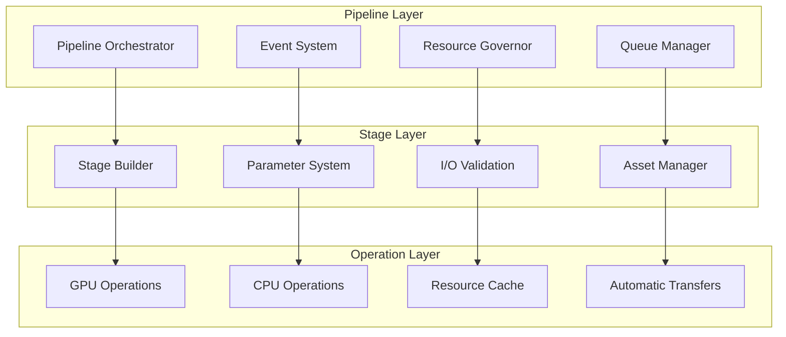

# MiniGPU Pipeline Design Document

## Executive Summary

MiniGPU Pipeline is a **hybrid CPU-GPU processing framework** for Dart applications, designed to democratize high-performance computing across platforms. The library provides an event-driven, stage-based architecture that intelligently orchestrates processing between CPU and GPU contexts, enabling everything from real-time audio visualization to complex machine learning pipelines. The design emphasizes **performance transparency**, **resource efficiency**, and **developer experience** through comprehensive monitoring, automatic resource management, and type-safe APIs.

## Architectural Philosophy

### Core Design Principles

1. **Hybrid Processing by Design**: CPU and GPU are complementary compute resources, not competing alternatives
2. **Performance Transparency**: Developers should understand resource usage, bottlenecks, and optimization opportunities
3. **Resource Intelligence**: Automatic memory management, caching, and platform-specific optimizations
4. **Event-Driven Architecture**: Comprehensive monitoring and debugging through structured events
5. **Type Safety Throughout**: Compile-time validation, runtime checking, and graceful error recovery
6. **Zero-Reconstruction Updates**: Runtime parameter changes without pipeline rebuilding

### Why Hybrid CPU-GPU?

**Traditional Approach**: Treat GPU as accelerator for CPU workflows

```
CPU → [prepare data] → GPU → [accelerate] → CPU → [post-process]
```

**Our Approach**: CPU and GPU as first-class processing contexts
```
Stream → [CPU analysis] → [GPU effects] → [CPU aggregation] → [GPU visualization]
```

**Benefits:**

- **Computational Flexibility**: Complex logic in Dart, parallel computation on GPU
- **Platform Compatibility**: Graceful degradation when GPU unavailable
- **Cost Optimization**: Use appropriate compute for each task
- **Development Velocity**: Rapid prototyping in familiar Dart environment

## System Architecture

### Three-Tier Execution Model



### Data Flow Philosophy

**Event-Driven Processing**: Every operation generates structured events for monitoring, debugging, and optimization.

**Intelligent Caching**: Unified resource cache across GPU shaders, CPU operations, and tensor data with LRU strategies and performance tracking.

**Automatic Memory Management**: System handles GPU↔CPU data transfers, memory allocation, and cleanup without developer intervention.

## Core Components

### 1. Pipeline Orchestrator

The pipeline serves as the **traffic controller** for data flow, resource allocation, and execution scheduling across heterogeneous compute contexts.

**Key Responsibilities:**

- **Stream Routing**: Direct data to appropriate stages based on processing requirements
- **Resource Coordination**: Manage GPU memory, CPU threads, and cross-context transfers
- **Event Aggregation**: Collect and distribute performance metrics, errors, and status updates
- **Queue Management**: Handle backpressure, priority scheduling, and real-time constraints

**Design Rationale**: Centralized orchestration enables sophisticated optimizations like:

- Batch processing for similar operations
- Predictive resource allocation
- Cross-stage performance analysis
- Dynamic quality adjustment

### 2. Stage System Architecture

Stages encapsulate **units of computation** with comprehensive I/O specifications, runtime configuration, and execution context requirements.

#### Stage Execution Contexts

**GPU Stages**: High-throughput parallel operations

- WebGPU compute shaders with parameter binding
- Tensor operations with automatic shape inference
- Resource pooling and shader compilation caching

**CPU Stages**: Complex logic and data processing

- Custom Dart processor functions
- Runtime code evaluation with isolate support
- Built-in operations (filtering, statistics, correlation)

**Automatic Context Switching**: When CPU stage follows GPU stage:

1. GPU tensor data automatically downloaded to CPU memory
2. CPU processing executes (potentially in isolate)
3. Results automatically uploaded to GPU for subsequent stages

#### I/O Port System Design

**Philosophy**: Comprehensive validation prevents runtime errors and enables sophisticated optimizations.

**Input Validation Strategies**:

- **Flexible**: Accept any tensor shape (most operations)
- **Constrained**: Dimension count or size boundaries
- **Exact**: Precise shape matching (ML models)
- **Custom**: Domain-specific validation functions

**Output Shape Calculation**:

- **Static**: Fixed output dimensions
- **Input-Dependent**: Shape derived from input tensors
- **Parameter-Dependent**: Shape based on runtime configuration
- **Computed**: Custom calculation functions

**Design Benefits**:

- Early error detection during pipeline construction
- Memory pre-allocation optimization
- Automatic buffer management
- Type-safe tensor operations

### 3. Parameter Management System

**Design Goal**: Enable sophisticated runtime control without pipeline reconstruction.

#### Type-Safe Parameter Architecture

**Parameter Categories**:

- **Scalar Parameters**: Numbers, booleans with validation constraints
- **Vector Parameters**: Multi-dimensional values with component validation
- **Enum Parameters**: Discrete choices with serialization support
- **String Parameters**: Text values with allowed value constraints

**Runtime Resolution System**:
Parameters are resolved during operation execution through a sophisticated binding system:

- `param:gain` → Current parameter value
- `tensor:input.shape.0` → Dynamic tensor dimension
- `shape:output` → Calculated output shape
- `size:buffer` → Memory allocation size

**Design Benefits**:

- Zero-cost runtime updates (no recompilation)
- Type safety with compile-time validation
- Automatic parameter interpolation for smooth transitions
- Comprehensive change event system

### 4. Resource Management Strategy

#### Unified Resource Cache Architecture

**Design Philosophy**: Treat shaders, tensors, and compute resources as cacheable assets with intelligent lifecycle management.

**Cache Categories**:

- **Shader Cache**: Compiled compute shaders with source versioning
- **Tensor Cache**: GPU memory buffers with usage tracking
- **Operation Cache**: Parameterized operation instances

**Cache Strategies**:

- **LRU Eviction**: Remove least recently used resources under memory pressure
- **Performance Tracking**: Monitor cache hit rates and memory efficiency
- **Predictive Preloading**: Load resources based on usage patterns

**Memory Hierarchy Optimization**:
```
GPU Registers → GPU Cache → GPU Memory → System Memory → Storage
    ↑              ↑           ↑            ↑            ↑
Ultra-fast     Fast      Moderate      Slower      Persistent
Limited        Small      Large        Very Large   Unlimited
```

#### Resource Governor Design

**Responsibilities**:

- **Memory Budget Management**:
 Prevent resource exhaustion
- **GPU Scheduling**: Coordinate multiple concurrent pipelines
- **Platform Optimization**: Leverage platform-specific capabilities
- **Fallback Strategies**: Graceful degradation when resources unavailable

**Adaptive Resource Allocation**:

- Monitor real-time resource usage
- Adjust quality settings based on available resources
- Predict resource requirements for future operations
- Balance performance vs. power consumption

### 5. Event-Driven Architecture

#### Comprehensive Event System

**Event Categories**:

- **Pipeline Events**: Start, stop, complete, error conditions
- **Stage Events**: Individual stage execution and performance
- **Parameter Events**: Runtime configuration changes
- **Resource Events**: Memory allocation, cache performance
- **Benchmark Events**: Performance metrics and optimization opportunities

**Event Processing Strategy**:

- **Real-time Monitoring**: Immediate event dispatch for critical conditions
- **Batch Analytics**: Aggregate events for performance analysis
- **Event Filtering**: Configurable event levels (debug, info, warning, error)
- **Event Persistence**: Optional event logging for post-analysis

**Design Benefits**:

- **Debugging Transparency**: Understand exactly what's happening
- **Performance Optimization**: Identify bottlenecks and optimization opportunities
- **Error Recovery**: Comprehensive error context for intelligent recovery
- **User Experience**: Provide meaningful feedback about processing status

### 6. Operation Execution Model

#### Three-Tier Operation Architecture

**Tier 1: StageOperation (Base)**

- Abstract operation interface
- Cache-aware execution with resource tracking
- Parameter resolution and validation
- Error handling and recovery

**Tier 2: Specialized Operations**

- **TensorOperation**: Built-in GPU tensor operations with caching
- **ShaderStageOperation**: Custom WGSL compute shader execution
- **CPUStageOperation**: Dart-based CPU processing with isolate support

**Tier 3: Operation Implementations**

- **GPU Operations**: Compiled shaders with parameter binding
- **CPU Operations**: Dart functions with performance monitoring
- **Hybrid Operations**: Coordinate CPU-GPU execution

#### Shader Generation and Compilation

**Dynamic Shader Generation**:

- Template-based shader generation with parameter substitution
- Conditional compilation based on runtime configuration
- Loop unrolling and optimization based on tensor shapes
- Automatic workgroup size calculation

**Shader Caching Strategy**:

- Cache compiled shaders with source code versioning
- Invalidate cache when parameters affect shader structure
- Share shaders across pipeline instances
- Monitor shader compilation performance

## Performance Characteristics

### Resource Utilization Targets

| Resource | Target Utilization | Optimization Strategy |
|----------|-------------------|----------------------|
| **GPU Memory** | 85-95% | Tensor pooling, compression |
| **GPU Compute** | 70-90% | Batch operations, pipeline parallelism |
| **CPU Memory** | 60-80% | Streaming processing, garbage collection |
| **Cache Hit Rate** | >90% | LRU eviction, predictive loading |

### Latency Classifications

**Ultra-Low Latency** (< 1ms): Parameter updates, cache hits
**Low Latency** (1-10ms): Simple GPU operations, CPU processing
**Moderate Latency** (10-50ms): Complex shaders, large tensor operations
**High Latency** (50ms+): Asset loading, shader compilation

### Memory Management Strategy

**Automatic Memory Management**:

- Pre-allocate tensor pools based on usage patterns
- Automatic garbage collection with performance monitoring
- Memory pressure detection and adaptive quality reduction
- Cross-context memory transfer optimization

**Platform-Specific Optimizations**:

- **Desktop**: Multi-GPU support, large memory budgets
- **Mobile**: Power-efficient processing, thermal management
- **Web**: WebGPU feature detection, graceful fallbacks

## Developer Experience Design

### Type Safety Strategy

**Compile-Time Validation**:

- Strong typing for tensor shapes and operations
- Parameter constraint checking
- I/O port compatibility validation

**Runtime Validation**:

- Comprehensive input validation with meaningful error messages
- Parameter range checking with automatic sanitization
- Resource availability checking with fallback suggestions

**Error Recovery Philosophy**:

- **Graceful Degradation**: Continue processing with reduced quality
- **Automatic Fallbacks**: CPU processing when GPU unavailable
- **Meaningful Errors**: Specific error messages with suggested fixes
- **Recovery Guidance**: Help developers fix configuration issues

### API Design Principles

**Fluent Builder Pattern**: Discoverable API with method chaining
**Sensible Defaults**: Minimize configuration for common use cases
**Progressive Disclosure**: Simple APIs for basic use, advanced options available
**Consistent Naming**: Predictable naming conventions across all APIs

### Debugging and Monitoring

**Performance Transparency**:

- Real-time performance metrics with historical tracking
- Resource usage monitoring with optimization suggestions
- Cache performance analysis with hit rate optimization
- Event-driven debugging with comprehensive context

**Development Tools**:

- Visual pipeline debugging with data flow visualization
- Parameter animation tools for smooth transitions
- Performance profiling with bottleneck identification
- Resource usage analysis with optimization recommendations

## Extensibility Model

### Custom Stage Development

**StageBuilder Extension Points**:

- Custom input/output validation functions
- Parameterized shader generation
- CPU processing function integration
- Asset management integration

**Plugin Architecture**:

- Platform-specific optimizations
- Custom operation implementations
- Hardware codec integration
- Domain-specific processing stages

### Platform Integration Strategy

**Cross-Platform Compatibility**:

- Unified API across desktop, mobile, and web platforms
- Platform-specific optimizations without API changes
- Graceful feature detection and fallback mechanisms
- Consistent behavior across different GPU architectures

**Hardware Acceleration Integration**:

- Neural processing unit (NPU) integration
- Hardware video codecs
- Specialized audio processing units
- Multi-GPU coordination and load balancing

## Future Architecture Evolution

### Serialization and Persistence

**Pipeline Configuration Management**:

- Complete pipeline serialization to JSON
- Version-controlled pipeline configurations
- Hot-reload capability for development
- A/B testing framework for optimization

### Inter-Pipeline Communication

**Pipeline Network Architecture**:

- Multi-pipeline coordination and data sharing
- Event propagation across pipeline boundaries
- Resource sharing and optimization
- Distributed processing coordination

### Cloud Integration Strategy

**Local-to-Cloud Continuum**:

- Seamless deployment from local development to cloud execution
- Resource scaling based on demand
- Cost optimization through intelligent resource allocation
- Edge deployment for low-latency processing

This architecture provides a solid foundation for high-performance, cross-platform media processing while maintaining the flexibility to evolve with changing requirements and emerging technologies. The emphasis on transparency, type safety, and developer experience ensures that the framework can scale from simple prototypes to production-scale applications.

## Serialization & Configuration (Draft v1)

### Goals

- Represent a full pipeline *network* (multiple pipelines + connections) in one JSON payload.
- Support real‑time UI editing (replace full blob or apply small parameter patch ops).
- Inline dynamic Dart code and WGSL shader code.
- Safe to load (frontend sanitizes / validates).
- Extensible via `type` discriminators and `schema_version`.

### Guiding Conventions

- snake_case keys
- `type` field on discriminated objects (e.g. `stage`, `operation`, `asset`)
- Omit null / defaults
- Deterministic ordering not required (stage order given by array index)

### Top-Level Object

```json
{
  "schema_version": 1,
  "pipelines": [ ... ],
  "inter_pipeline_links": [ ... ],
  "assets": [ ... ],
  "notes": "optional freeform"
}
```

### Pipeline Object

```json
{
  "type": "pipeline",
  "id": "audio_visualizer",
  "queue": { "strategy": "latest_only", "batch_size": 1 },
  "enable_benchmarking": true,
  "debug_enabled": false,
  "stages": [ ... ],
  "connections": [
    { "from_stage": "window", "to_stage": "fft" },
    { "from_stage": "fft", "to_stage": "custom_cpu" }
  ],
  "parameters": { "global_gain": 1.0 },           // optional global scope
  "metadata": { "created_by": "ui" }
}
```

### Stage Object

```json
{
  "type": "stage",
  "stage_id": "window",
  "stage_kind": "WindowStage",            // maps to fixed registry
  "order": 0,                             // optional (array index is primary order)
  "execution_target": "gpu",              // gpu | cpu (omit if inferred)
  "resource": {
    "requirements": {
      "priority": "normal"
    }
  },
  "inputs": [
    { "name": "audio", "port_type": "audio", "min_samples": 256 }
  ],
  "outputs": [
    { "name": "windowed", "port_type": "tensor", "shape_policy": "flexible" }
  ],
  "parameters": {
    "window_type": "hann",
    "gain": 1.0
  },
  "operations": [ ... ],                  // only for composite / dynamic stages
  "dynamic_code": null,                   // reserved (unused in static stage kinds)
  "assets": [ "model_weights" ]
}
```

### Operation Object (Inside Dynamic / Composite Stage)

Fixed registry or dynamic CPU / shader:

```json
{
  "type": "operation",
  "op_kind": "tensor_op",                // tensor_op | cpu | dynamic_cpu | shader | merge | split
  "operation": "fft",                    // for tensor_op
  "input_keys": ["temp_0"],
  "output_keys": ["temp_1"],
  "arguments": { "args": [2.0] }
}
```

Dynamic CPU:

```json
{
  "type": "operation",
  "op_kind": "dynamic_cpu",
  "input_keys": ["audio"],
  "output_keys": ["processed"],
  "dart_code": "Future<Map<String,TypedData>> main(...) { ... }"
}
```

Shader:

```json
{
  "type": "operation",
  "op_kind": "shader",
  "input_keys": ["input"],
  "output_keys": ["output"],
  "wgsl": "@compute @workgroup_size(64)\nfn main(...) { ... }",
  "shader_parameters": { "multiplier": 2.0 },
  "workgroup_size": [64,1,1]
}
```

### Asset Object (Skeleton)

```json
{
  "type": "asset",
  "name": "model_weights",
  "asset_type": "weights",
  "source": {
    "source_type": "file",
    "path": "assets/weights.bin"
  },
  "loading": { "strategy": "preload", "cache_policy": "both" },
  "metadata": { "hash": "sha256:..." }
}

```
(Generation parameters for procedural assets go under `metadata.generator` later.)

### Inter-Pipeline Link

```json
{
  "from": { "pipeline": "audio_source", "output": "fft_output" },
  "to":   { "pipeline": "audio_effects", "input": "spectrum_input" },
  "mode": "latest_autorun"
}
```

- mode (serialized string for enum `InterPipelineLinkMode`):
  - "latest"         → Router stashes the latest source output tensor into the target external input; the target can call runOnce({}) without explicit input.
  - "latest_autorun" → Router stashes as above and automatically triggers target.runOnce({}) when the source completes; consumed external inputs are cleared after the autorun.
- Tensors are treated as immutable when routed across pipelines (shared by reference without mutation).
- Routing is driven by PipelineRunCompleteEvent for both runOnce and streamed runs. Pipelines publish their latest outputs at the end of:
  - per-stream processing (individual path), and
  - merged-stream processing (merged path).
- Validation checks ensure pipelines/ports exist and warn on shape mismatches (future enhancement).

### Parameter Serialization

- Stage `parameters` object lists current values (defaults omitted optional?—for now include all to simplify UI diff).
- Parameter metadata (min/max/type) not required in runtime payload; UI can request a separate “capabilities” document or embed optional `parameter_defs`.

Future extension:

```json
"parameter_defs": {
  "gain": { "type": "float", "min": 0.0, "max": 2.0, "default": 1.0, "description": "Audio gain" }
}
```

### Patch (Runtime Updates)

Small messages over a channel or local apply:

```json
{
  "type": "patch",
  "pipeline_id": "audio_visualizer",
  "ops": [
    { "op": "set_param", "stage_id": "window", "name": "gain", "value": 1.25 },
    { "op": "replace_stage", "stage": { ...full stage object... } }
  ]
}
```

Accepted ops (initial set):

- set_param
- set_params (bulk)
- replace_stage
- remove_stage
- insert_stage (with order or index)
- reorder_stages (list of ids)
- add_operation (within dynamic stage)
- remove_operation
- replace_operation

### Validation & Logging

Loader returns:

```json
{
  "ok": false,
  "errors": [
    { "code": "UNKNOWN_STAGE_KIND", "message": "Stage kind X not registered", "path": "pipelines[0].stages[2].stage_kind" }
  ],
  "warnings": [
    { "code": "UNUSED_ASSET", "message": "Asset 'weights2' not referenced" }
  ]
}
```

UI surfaces both lists in code / config editor panel. Runtime execution errors (dynamic code compile, shader compile) produce `runtime_errors` events appended to a rolling log.

### Versioning & Migration

- `schema_version` integer.
- On bump add migration pass: `migrators = {2: migrateV1toV2, 3: ...}`.
- Unknown higher version: reject with `UNSUPPORTED_SCHEMA_VERSION`.

### Security Notes (Future)

- Dynamic Dart code sandboxing (Web Workers / isolate) planned.
- WGSL lint: restrict disallowed extensions & enforce workgroup limits.
- Hash + optional signature for dynamic code assets later.

### Shape & Dependency Expression System (v1)

Goals:

- Declarative shape metadata so UI can reason about buffers before execution.
- Avoid embedding executable Dart for shapes in serialized JSON.
- Provide lightweight references + simple arithmetic/composition.
- Map directly onto existing runtime resolution (`param:`, `tensor:`, `shape:`, `size:`).

Principles:

- Pure, side‑effect free.
- Deterministic (no runtime data inspection beyond known input shapes/parameters).
- Progressive: start minimal, allow extension with new ops.

#### Reference Tokens (already supported in arguments / named_arguments)

| Token Prefix | Meaning | Example | Resolved To |
|--------------|---------|---------|-------------|
| param:       | Stage or pipeline parameter value | "param:gain" | numeric / bool / string |
| tensor:      | Pass-through tensor object (for op args) | "tensor:input_a" | Tensor instance |
| shape:       | Shape list of a tensor | "shape:input_a" | List<int> |
| size:        | Byte size of tensor buffer | "size:input_a" | int |

These remain string literals inside `arguments` or `named_arguments` arrays/maps.

#### Port Serialization

Input port (example):
```json
{
  "name": "audio",
  "port_type": "audio",
  "shape_policy": "flexible",
  "min_dimensions": 1,
  "max_dimensions": 2,
  "required": true
}
```

Output port with fixed shape:
```json
{
  "name": "mel_spectrum",
  "port_type": "tensor",
  "size_policy": "fixed",
  "shape_expr": { "op": "fixed", "shape": [128] }
}
```

Output port derived from input:
```json
{
  "name": "windowed",
  "port_type": "tensor",
  "size_policy": "input_dependent",
  "shape_expr": { "op": "same_as", "input": "audio" }
}
```

Parameter dependent:
```json
{
  "name": "feature_vector",
  "size_policy": "parameter_dependent",
  "shape_expr": { "op": "param_list", "param": "feature_dims" }
}
```

Computed (multi-input):
```json
{
  "name": "concat",
  "size_policy": "computed",
  "shape_expr": {
    "op": "concat_along",
    "axis": 0,
    "inputs": ["a", "b"]
  }
}
```

#### Shape Expression DSL (initial ops)

| op              | Fields                                   | Description |
|-----------------|-------------------------------------------|-------------|
| fixed           | shape: List<int>                          | Literal shape |
| same_as         | input: string                             | Copy shape of input |
| pick_dims       | input: string, dims: List<int>            | Extract subset of dims |
| replace_dim     | input: string, axis: int, value: int/ref  | Replace one dimension |
| param_scalar    | param: string                             | Single-dim vector [param] |
| param_list      | param: string (expects List<int>)         | Use parameter list |
| concat_along    | axis: int, inputs: List<string>           | Concatenate shapes along axis |
| broadcast_pair  | a: string, b: string                      | Broadcast rules (pair) |
| scale_dim       | input: string, axis: int, factor: number  | Multiply one dimension |
| pad_dim         | input: string, axis: int, before:int, after:int | Pad dimension |
| reduce_axes     | input: string, axes: List<int>            | Remove / reduce axes (result dims dropped) |
| first_n         | input: string, axis: int, n: int/ref      | Truncate dimension |
| infer_remaining | total: int/ref, known: List<{axis,value}> | Compute one remaining dim by division |
| stack           | inputs: List<string>, axis: int           | Stack inputs, inserting new axis |
| reshape_flat    | input: string                             | Collapse all dims → [product] |

Ref fields may reference parameters by wrapping with reference object:
```json
{ "op": "scale_dim", "input": "a", "axis": 1, "factor": { "ref": "param:upsample_factor" } }
```

Minimal shortcut: if a numeric field is a string starting with `param:` it is treated as a reference (no extra object needed).

#### Evaluation Order

1. Gather input shapes (already known from upstream).
2. Build eval context:
   ```
   ctx = {
     params: {...},
     shapes: { "a": [..], "b": [..] }
   }
   ```
3. Evaluate shape_expr recursively; any reference resolution failure becomes a validation error.
4. Cache resolved shape in stage for quicker subsequent validations.

#### Validation Rules

- Unknown `op` → error code: SHAPE_OP_UNKNOWN
- Missing required field → SHAPE_FIELD_MISSING
- Axis out of range → SHAPE_AXIS_OOB
- Negative / zero dim (unless explicitly allowed) → SHAPE_INVALID_DIM
- In concat / stack: ensure rank compatibility.

#### Example: FFT Output (pass-through)

```json
{
  "name": "fft_output",
  "size_policy": "computed",
  "shape_expr": {
    "op": "same_as",
    "input": "windowed"
  }
}
```

#### Example: Broadcast Add Operation

Operation config argument:
```json
"arguments": {
  "lhs_shape": "shape:input_a",
  "rhs_shape": "shape:input_b"
}
```
Output port:
```json
{
  "name": "added",
  "size_policy": "computed",
  "shape_expr": { "op": "broadcast_pair", "a": "input_a", "b": "input_b" }
}
```

#### Future Extensions (not implemented yet)

| Feature | Note |
|---------|------|
| symbolic expressions (e.g. "shape:a[0] * 2") | Could add `op: "expr", expr: "a0 * 2"` with tiny evaluator |
| conditional shapes | `op: "if_param", param: "mode", cases: { "small":[64], "large":[256] }` |
| multi-branch fallback | `op: "first_valid", candidates:[...]` |

### Operation Argument Reference Enhancements

All operation `arguments` / `named_arguments` keys support embedded reference strings (`param:`, `tensor:`, `shape:`, `size:`). For structured refs (future), we may allow:
```json
{ "ref": "param:gain" }
```
Currently not required—keep simple.

### Built-In Operation Registry Snapshot

Tensor operations (gpu_tensor):
```
addScalar, multiplyScalar, subtractScalar, divideScalar,
add, multiply, subtract, divide, max, min,
abs, fft, sqrt, exp, log, sin, cos, tanh,
sum, mean, normalize
```

CPU (prebuilt):
```
passthrough, debug_info
```

Dynamic CPU & shader ops: free-form (validated by runtime).

### Error Codes (New Additions)

| Code | Description |
|------|-------------|
| SHAPE_OP_UNKNOWN | Unrecognized shape_expr op |
| SHAPE_FIELD_MISSING | Required field missing in shape_expr |
| SHAPE_AXIS_OOB | Axis outside input rank |
| SHAPE_INCOMPATIBLE | Inputs incompatible (concat/broadcast) |
| SHAPE_PARAM_MISSING | Referenced parameter missing |
| SHAPE_RESULT_EMPTY | Evaluated to empty or invalid shape |
| ARG_REFERENCE_INVALID | Could not resolve param:/tensor:/shape:/size: |
| ARG_TYPE_MISMATCH | Resolved argument type invalid for operation |
